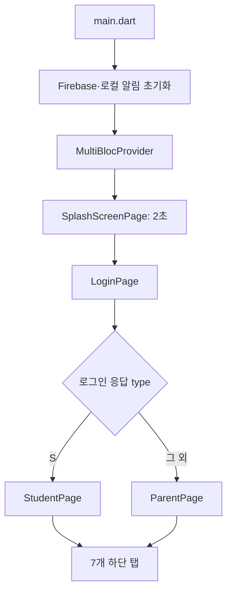
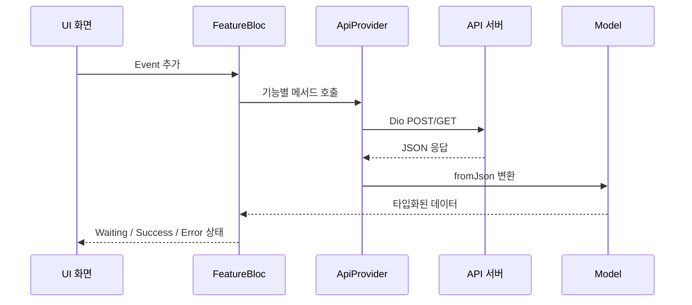

# 아키텍처

## 실행 및 화면 전환

`main.dart`는 세로 화면을 강제하고 immersive 모드를 설정한다. Firebase를 초기화한 뒤 FCM 토큰을 얻고, 포그라운드 메시지는 로컬 알림으로 표시한다. 앱 전역에서 필요한 29개 BLoC은 `MultiBlocProvider`로 주입된다.

## 디렉터리 책임

| 경로 | 책임 |
| --- | --- |
| `lib/ui/` | 화면과 사용자 상호작용. 역할별 홈, 오늘/지난 계획, 단어장, 회원, 문의, 설정 화면을 둔다. |
| `lib/bloc/<기능>/` | 기능별 `event`, `state`, `bloc`을 분리한 상태 관리 계층이다. 각 BLoC은 API 호출 결과를 상태로 발행한다. |
| `lib/network/api_provider.dart` | Dio 기반 HTTP 통신, 서버 응답 코드 해석, API별 요청/모델 변환을 담당한다. |
| `lib/model/` | 서버 응답 데이터 모델이다. |
| `lib/config/` | 서버 URL, 엔드포인트, 색상, 런타임 전역 상태를 둔다. |
| `lib/reusable/` | 공통 AppBar·다이얼로그·토스트·로딩 UI와 검증 유틸리티다. |
| `lib/device_apps/` | Android 설치 앱 검사에 사용하는 로컬 Flutter 플러그인이다. |

## 기능 호출 흐름

예를 들어 로그인은 `Login` 이벤트에서 `ApiProvider.login()`을 호출하고, `LoginWaiting`, `LoginSuccess`, `LoginError`를 발행한다. 화면은 `BlocListener`/`BlocBuilder`로 로딩 다이얼로그, 오류 토스트, 다음 화면 이동을 처리한다.

## 인증과 런타임 상태

로그인 성공 후 액세스 토큰과 역할을 `lib/config/constant.dart`의 전역 변수 `ACCESSTOKEN`, `TYPE`에 저장한다. 인증이 필요한 요청은 `ApiProvider.postTokenConnect()`가 `accesstoken` HTTP 헤더를 넣는다.

학부모는 `TARGETID`, `TARGETNAME`으로 조회 대상을 선택한다. 학생 홈과 학부모 홈 모두 공통 탭 구성을 가지지만, 학부모 화면은 연결된 학생을 선택해 그 학생의 계획/단어장 기록을 조회한다.

로그인 ID/PW는 `flutter_secure_storage`에 저장해 자동 입력에 사용한다. 토큰 자체는 영속 저장하지 않으므로 앱을 다시 시작하면 재로그인이 필요할 수 있다.

## 화면 구성

학생/학부모 메인 컨테이너(`StudentPage`, `ParentPage`)는 스와이프를 막은 `PageView`와 `ConvexAppBar`로 아래 7개 탭을 전환한다.

1. 홈
2. 오늘 계획
3. 지난 계획
4. 단어장
5. 1:1 문의
6. 알림
7. 설정

직접 `Navigator.push`를 사용하는 상세 화면과 탭 내부 `PageView`가 함께 있으므로, 새 화면을 추가할 때는 어느 방식의 전환인지 일관되게 선택해야 한다.
